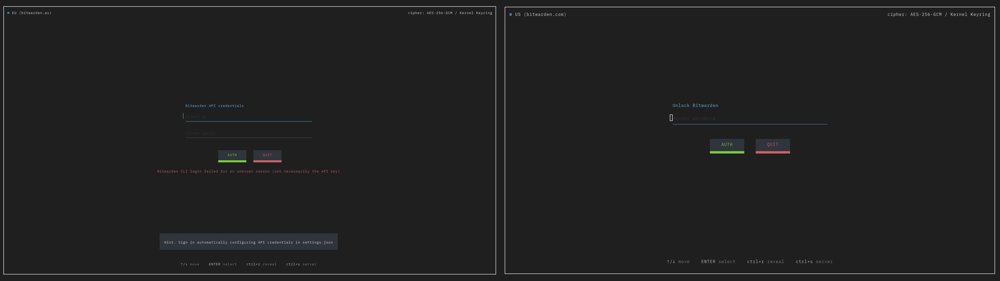
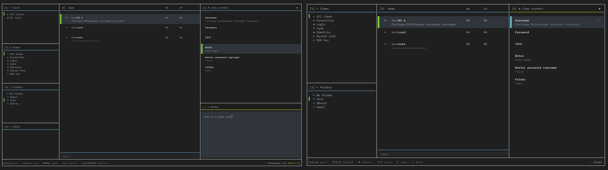
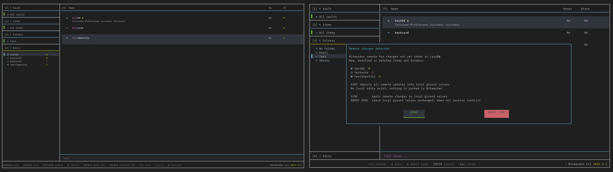

# LazyBW — A TUI to manage the Bitwarden CLI

LazyBW is a terminal interface for the official [Bitwarden CLI (`bw`)](https://bitwarden.com/help/cli/). It makes everyday vault management easier without replacing Bitwarden or its CLI.

**Snap installation** (once the LazyBW package is published):

```bash
sudo snap install lazybw
lazybw
```

> **Independent project.** LazyBW and its contributors are not affiliated with, endorsed by, or sponsored by Bitwarden, Inc.

## Dependencies

| Requirement | Purpose |
| --- | --- |
| [`bw`](https://bitwarden.com/help/cli/) **(required)** | All Bitwarden authentication and remote vault operations; must be available on `PATH`. |
| A UTF-8 terminal **(required)** | A terminal with true-color and mouse support is recommended. |
| `wl-copy` (Wayland), `xclip` (X11), or `clip.exe` (WSL); Windows `clip` **(optional)** | Copying values to the system clipboard. |
| `tput` **(optional)** | Improved Backspace / Ctrl+Backspace detection through terminfo. |
| Go **(build only)** | Compiling from source; not needed for a Snap installation. |

Go dependencies (fetched through Go modules): [`awesome-gocui/gocui`](https://github.com/awesome-gocui/gocui), [`gdamore/tcell/v2`](https://github.com/gdamore/tcell), [`ericlagergren/siv`](https://github.com/ericlagergren/siv), and [`golang.org/x/crypto`](https://pkg.go.dev/golang.org/x/crypto).

## Sign in to Bitwarden

LazyBW supports Bitwarden's **US and EU** cloud regions and API-key authentication, followed by unlocking your vault with your master password. You can enter credentials in the TUI or load your API key from a local file.

On first launch, LazyBW creates `settings.jsonc` and `keybinds.jsonc` in `~/.config/lazybw/` (or `LAZYBW_CONFIG_DIR`). Existing `.json` files are also supported. To prefill your API credentials and select a region, edit the `authentication` section of `settings.jsonc`:

```jsonc
"authentication": {
  "client_env_path": "$HOME/.config/lazybw/credentials.env",
  "default_server": "eu"
}
```

- `client_env_path`: path to a credentials file, or `null` to enter credentials manually. `$HOME` and `~/` are supported.
- `default_server`: `"us"` (default) or `"eu"`.

The credentials file accepts ordinary `.env` assignments, with or without `export`:

```dotenv
BW_CLIENTID=user.xxxxxxxx-xxxx-xxxx-xxxx-xxxxxxxxxxxx
BW_CLIENTSECRET=your-client-secret
```

Keep this file out of Git and restrict access to it (`chmod 600`). It contains your **API key**, not your master password.



## Browse and manage your vault

Browse items and folders, inspect or edit fields, create and delete entries, search, and review **staged edits** before pushing them. LazyBW also supports synchronization and reviewing remote changes. These are interfaces to functionality already available through `bw`.

**The only additional vault capability** is an optional, encrypted, **read-only local replica of your personal vault** for offline access. Organization-owned items are not included.

## Keep an encrypted local replica

In `settings.jsonc`, configure `local_replication`:

```jsonc
"local_replication": {
  "save_vault": true,
  "vault_path": "$HOME/.local/share/lazybw/bw-vault",
  "vault_encryption": "aes-256-gcm"
}
```

- `save_vault`: `true` to enable replication; `false` (default) to disable it.
- `vault_path`: destination file; its parent directory must already exist (for the example, run `mkdir -p ~/.local/share/lazybw`). `$HOME` and `~/` are supported.
- `vault_encryption`: one of the algorithms below (default: `aes-256-gcm`).

| Encryption algorithm | Go implementation / source repository |
| --- | --- |
| `aes-256-gcm` | [Go standard library — `crypto/aes` and `crypto/cipher`](https://pkg.go.dev/crypto/cipher) |
| `aes-256-gcm-siv` | [`github.com/ericlagergren/siv`](https://github.com/ericlagergren/siv) |
| `xchacha20-poly1305` | [`golang.org/x/crypto/chacha20poly1305`](https://pkg.go.dev/golang.org/x/crypto/chacha20poly1305) |

All three use **Argon2id** ([`golang.org/x/crypto/argon2`](https://pkg.go.dev/golang.org/x/crypto/argon2)) to derive the encryption key from your master password. Replicas are updated from confirmed personal-vault data, exclude unsaved edits, and can be opened offline with the password used to encrypt them. **Local mode never writes to Bitwarden.**



## Synchronize and review changes

Local edits are staged for review before being pushed. When remote data has changed, **soft sync** keeps your staged edits while updating their remote baseline; **hard sync** discards the staged edits and adopts the remote values. You can also abort the operation.



## Customize connection checks

LazyBW checks the availability of the US and EU endpoints. To use different **HTTPS** URLs for those reachability checks, edit `network` in `settings.jsonc`:

```jsonc
"network": {
  "us_ping_url": "https://api.bitwarden.com",
  "eu_ping_url": "https://api.bitwarden.eu"
}
```

Both values must be HTTPS URLs that respond to a `HEAD` request. These settings change **connectivity checks only**, not the Bitwarden servers used for authentication or vault operations.

## In-memory secret protection

LazyBW encrypts sensitive values held in its working state using **AES-256-GCM** and a randomly generated, per-session key. It uses one of two key-storage backends:

- **Linux Kernel Keyring (preferred):** stores the session key in the kernel keyring when available.
- **Memory (fallback):** keeps the key in the process when the kernel keyring cannot be used, including on unsupported platforms.

The key is revoked or cleared when the session closes, where practical. This reduces the time secrets remain exposed in application state; it **does not guarantee** that plaintext never appears transiently in process memory or when communicating with `bw`.

## Development and maintenance

AI tools were used during the development of LazyBW. The project was created primarily for personal use, and **regular maintenance is not guaranteed**. It is published so others can use, study, fork, and modify it, subject to the repository's license.
